# 🐾 AgentKennel — real Claude Code terminals in your browser

A dozen Claude Code agents, kept and fed on your own server: open any of them from a
browser tab or Telegram, close the tab, and they keep working.

- **Real Claude Code terminals** — the actual `claude` TUI in tmux, not a chat wrapper.
- **On your own VPS** — your server, your Claude subscription, open source (MIT).
- **Browser and Telegram, even from your phone** — type, paste, dictate, tap buttons.
- **Keeps working when you close the tab** — and resumes the same conversation after a reboot.
- **A shared task board** — agents log their work there and are nudged to keep going until
  the task is closed.
- **Full control of the server, or a Docker sandbox** — your choice at install time.

<p>
  <a href="https://github.com/yanhs/agentkennel/actions/workflows/install.yml"></a>
  <a href="LICENSE"></a>
  
</p>

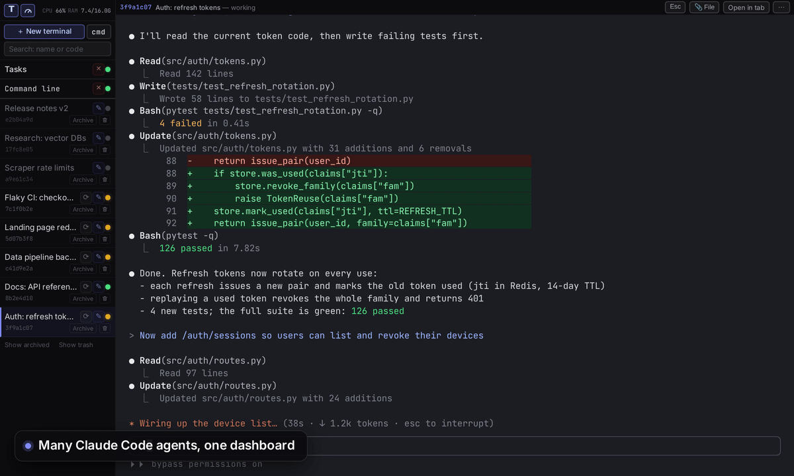

<sub>demo data</sub>

```bash
curl -fsSL https://raw.githubusercontent.com/yanhs/agentkennel/master/install.sh | bash
# → prints a one-time link: https://<your-ip-with-dashes>.sslip.io/login?setup=…
#   open it and set your password there
```

Run as a normal user with sudo — on a root-only VPS: `adduser deck && usermod -aG sudo deck`,
then log in as deck. Want to read it first?

```bash
curl -fsSL https://raw.githubusercontent.com/yanhs/agentkennel/master/install.sh -o install.sh && less install.sh
bash install.sh
```

Or keep the agents inside a container:

```bash
git clone https://github.com/yanhs/agentkennel.git && cd agentkennel
docker compose up -d                           # → http://<your-vps-ip>:8765
docker compose logs agentkennel | grep setup   # the one-time link that sets the password
```

> ⚠️ **What the agents may do.** AgentKennel starts Claude Code with
> `--dangerously-skip-permissions`, so agents don't stop to ask before each command. On a
> server install they run as your user, with your sudo: they install packages, set up
> databases, nginx, HTTPS and Docker themselves. That is the point, and it is why it belongs
> on a **dedicated VPS, not your laptop** — or in the Docker sandbox, where they can't
> touch the host. [Safety](#-safety-what-agents-never-do-without-you) lists what they never
> do without you.

**Latest: v2.1.1** — your own names on the Server page; v2.1.0: the internal names follow the new name; since 2.0: 📎 File uploads, a
one-time setup link for the first password, services that outlive a terminal, safety guards
→ [CHANGELOG](CHANGELOG.md)

## Why AgentKennel

- **The real terminal.** Each agent is the actual `claude` TUI in its own `tmux` session on
  your server, shown through `ttyd`. Open it later from anywhere: it's the same terminal.
- **Sessions survive restarts.** Close the browser, restart the service or reboot: every
  terminal reopens the same conversation where it left off (`claude --resume`).
- **Copy and paste like a desktop terminal.** Ctrl+V pastes text and images (dictation apps
  like Wispr Flow work), Ctrl+C copies a selection; drop screenshots straight in.
- **Agents that finish.** Each agent puts its task on the shared board before editing, and
  is nudged to keep going until the task is closed, or to set a timer.
- **Telegram controls the same terminals.** Pick one, type or send a voice note, get the
  screen back; Claude's multiple-choice questions arrive as buttons.
- **Many agents on one small server.** At most 12 stay loaded; idle ones are unloaded and
  resume on click. The **Server** tab shows which agent or build uses the CPU and memory.
- **Services that outlive a terminal.** A tunnel, a site's server or a bot goes into
  `.services/<name>.sh`; the keeper starts it, restarts it after a crash and keeps its log.
- **Your subscription, your box.** The official Claude Code CLI with your Claude
  subscription (or an API key). AgentKennel itself sends no telemetry (Claude Code talks
  to Anthropic, as always).

| Services on the Server page | /services in Telegram |
|---|---|
| 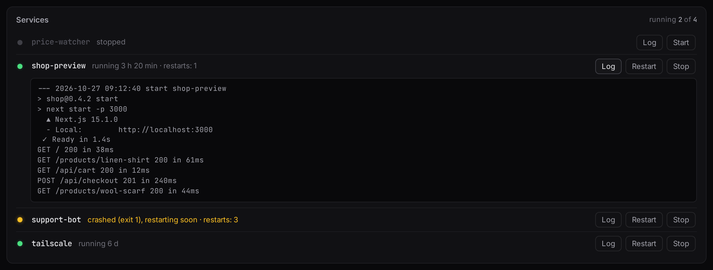 | 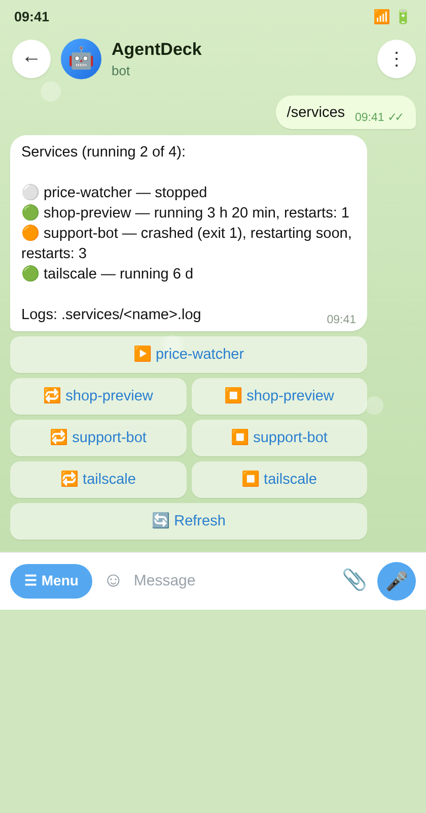 |

## How it compares

| | AgentKennel | Remote Control (Anthropic) | CloudCLI / claudecodeui | plain tmux + ssh |
|---|---|---|---|---|
| What you drive | the real `claude` TUI, in a browser tab | your session, in claude.ai/code or the Claude app | a chat UI, plus a shell tab | the real TUI, in an SSH client |
| Where Claude runs | your VPS | your own machine, which must stay on | your machine, or their paid cloud | your server |
| From the phone | any browser, and Telegram (voice, buttons) | the official Claude app | mobile web | an SSH app |
| Many agents at once | ✅ with a memory limit, idle unloading, archive | ✅ server mode | ✅ | ✅ by hand |
| Back after a reboot | ✅ same conversations | restart `claude` | restart its server | ❌ resume each by hand |
| Shared task board | ✅ | ❌ | TaskMaster, optional | ❌ |
| Other agents (Codex, Cursor…) | ❌ Claude only | ❌ Claude only | ✅ | anything |
| Price | free, MIT | included in Pro / Max / Team / Enterprise | free (AGPL); cloud from €7/mo | free |

Want one session from your own laptop? Use Remote Control. AgentKennel is for a dozen agents
that live on a server around the clock. (Rather have no server at all? Claude Code on the
web runs in Anthropic's cloud.)

## ✨ Features

- **Named terminals.** Each terminal is one Claude conversation, with one code everywhere:
  the dashboard, tmux (`cs-<code>`), logs, the task board, Telegram and the transcript.
- **New, rename, reorder, search.** **＋ New**, ✎ to rename, drag to reorder;
  search finds terminals by name or code, archived ones too.
- **Archive — keep it, unload it now.** Click an archived terminal to restore and open it.
  **Move to Trash** for ones you don't need; nothing is erased until you empty the trash.
- **⟳ Restart** Claude in the same conversation, from the dashboard or `/restart` in Telegram.
- **Only what you use stays in memory.** At most 12 loaded (`AGENTKENNEL_MAX_ACTIVE`); an idle
  terminal unloads after 2 hours, but never one with an open tab or a pending timer.
- **Give an agent any file.** **📎 File** (or drop files on the terminal) uploads up to
  100 MB each to a private folder on the server and types the path into the terminal.
- **Browser terminals, no SSH.** Select with the mouse to copy, Ctrl+Shift+V or ⌘V to paste;
  long scrollback. A `cmd` line gives you a plain `bash` shell next to the agents.
- **Claude usage at a glance.** Next to `cmd`, `5h 7%` / `wk 9%`: the 5-hour and weekly
  windows of your Claude subscription, as in `/usage` (amber from 70 %, red from 90 %); hover
  for reset times and today's busiest terminals. Read from `CLAUDE_CODE_OAUTH_TOKEN` in
  `~/.claude/oauth.env` with one tiny request at most every 10 minutes.
- **One login for everything.** A cookie-session login protects the dashboard, the
  terminals and every API; change the password with **⋯ → Password**.
- **HTTPS with no domain.** A Let's Encrypt certificate for `<your-ip>.sslip.io`, or your own
  domain with `--https your-domain.com`.
- **Shared task board.** Live, with search, filters and the terminal behind each task;
  click a terminal's code to see only its tasks.
- **Server page.** CPU and memory over 15 minutes, split into agents, sites and apps,
  background jobs and the system; each row expands into its processes.
- **Agents know where they run.** Their `~/.claude/CLAUDE.md` says the dashboard and
  Telegram are two windows into the same terminals. A CLAUDE.md of yours is never touched.
- **Works on a phone.** Swipe to scroll, press and hold to select; a key bar has Ctrl+C,
  Tab, the arrows and Enter.
- **Dark and light theme**, in the **⋯** menu. Terminals stay dark.

## 🚀 Quick start

### On your server — agents get the whole server

Ubuntu 22.04 / 24.04 or Debian 12, x86_64 or aarch64. Anything else stops without changes
and points you to the Docker sandbox.

```bash
curl -fsSL https://raw.githubusercontent.com/yanhs/agentkennel/master/install.sh | bash
```

1. At the end the installer prints the address and a **one-time setup link**,
   `https://<host>/login?setup=<token>`. Only that link can set the password, so a stranger
   who finds the fresh server first can't. Lost it? Run the install command again.
2. Open it and set your password.
3. **＋ New** (it opens in `~/projects`), sign in to Claude once, give the agent a task.

- **HTTPS by default, no domain needed.** Ports 80 and 443 free → a trusted certificate for
  `https://<your-ip-with-dashes>.sslip.io`. Only 443 taken → the same on `:8443`. Otherwise a
  self-signed certificate on `https://<your-ip>:8765` that the browser warns about once.
  `--https your-domain.com` uses your own domain; `--http` turns encryption off.
- **What it installs:** `tmux`, `python3`, `git`, `curl`, `ttyd`, Caddy, Node.js 22 (if there
  is no Node 18+), Claude Code (pinned), the repo in `~/agentkennel`, and the guard hooks in your
  `~/.claude` (merged, never overwritten; `AGENTKENNEL_GUARDS=0` skips them).
- **How it runs:** systemd services as your user, started at boot:
  `systemctl status 'agentkennel-*'`, `journalctl -u agentkennel-status`.
- **Update or repair:** run the same command again; running agents keep running.
  **Remove:** `~/agentkennel/install.sh --uninstall` keeps your terminals, board and password;
  add `--purge` to delete the folder too (only one the installer cloned itself).

### Docker sandbox — agents stay inside a container

You need Docker and one free TCP port (`8765`, or `AGENTKENNEL_PORT=9000`) open in your
firewall. Docker-published ports bypass `ufw`.

```bash
git clone https://github.com/yanhs/agentkennel.git && cd agentkennel
docker compose up -d
docker compose logs agentkennel | grep setup   # → /login?setup=<token>
```

`docker compose up -d` downloads the ready image of the latest release,
`ghcr.io/yanhs/agentkennel` (amd64 and arm64), so nothing is built on your machine.
`AGENTKENNEL_VERSION=2.2.0 docker compose up -d` pins a version;
`docker compose up -d --build` builds your checkout instead.

1. Open `http://<your-vps-ip>:8765/login?setup=<token>` and set the password.
2. **＋ New**, then sign in to Claude once: it asks for a colour theme, then how to
   log in (subscription or API key). The login is kept in a volume.
3. Want HTTPS? `./https.sh` (a free `<ip>.sslip.io` name, needs ports 80 and 443) or
   `./https.sh your-domain.com`; `./https.sh --off` goes back.

Agents work in `/work`, a named volume that survives `docker compose down` and rebuilds; to
use your own project, replace that line in `docker-compose.yml` with `./my-project:/work`.
The price of the sandbox: agents can't manage the host, a site they start inside isn't
reachable from outside, `apt` installs vanish when the container is re-created, and there
is no systemd.

Upgrading from AgentDeck: run the installer again; it moves the services to the new names and keeps your terminals, board and password.

## 🔒 Safety: what agents never do without you

An agent with a shell can do in a second what takes a day to undo: push a key to a public
repo, close every terminal with one careless `pkill`, mail a client. AgentKennel tells its
agents the rules, and holds the worst of them in code.

**The rules** live in the `~/.claude/CLAUDE.md` AgentKennel writes for its agents (blocks
marked `<!-- agentkennel-safety -->`, `<!-- agentkennel-tdd -->`, `<!-- agentkennel-links -->`;
delete a block and keep its mark line to opt out):

- No secrets or personal data (keys, tokens, passwords, IPs, phone numbers, user ids) in a
  commit, a public file or a link. Files are added by name; tests use made-up values.
- Signals only to processes the agent started — never `pkill -f` or `killall` by name.
- Ask first before deleting what it didn't create, force-pushing, dropping data or sending
  anything to people. A yes covers that one action only.
- A job that runs later (a timer, cron) reports its result, success and failure alike.
- Test first: a code change starts with a failing test, a bug fix with one that reproduces it.
- A link you should open goes alone on the last line, so chat apps don't glue a period to it.

**The guards** are Claude Code hooks that run before every shell command. Each blocks with
a message saying what it found and what to do instead, has a visible one-time override,
and lets the command through if it fails itself.

| Guard | Stops | Override |
|---|---|---|
| `guard_kill.py` | a signal to a process outside the agent's own tree (`pkill`/`killall` patterns, `kill $(pgrep …)`, `tmux kill-server`); it lists who would be hit | `KILL_OK=1` |
| `guard_email.py` | mail to people: `sendmail`, `smtplib`, mail-service APIs (Resend, SendGrid, Mailgun, SES…), also inside `docker exec` | `SEND_APPROVED=1`, after you saw the text, sender and recipient |
| `guard_secrets.py` | a commit or push with a private key, a known token (Telegram, Anthropic, GitHub, AWS, Slack) or this server's public IP | `SECRETS_OK=1` |

Each guard exists because of a real incident: a `pkill -f` pattern with a `|` in it once
matched the tmux server that hosts every terminal and closed them all, and a mail sent from
the wrong address can't be called back.

What they can't see: a script run from a file (`bash x.sh`), or a signal or mail sent from
inside a program. They are a seat belt, not a sandbox — for that, use Docker. Two more hooks
keep agents on the task board; all of them are on by default and off with
`AGENTKENNEL_GUARDS=0` ([details](docs/manual-setup.md#hooks)).

## 🤖 Telegram

Create a bot with [@BotFather](https://t.me/BotFather), find your numeric user id (for
example with [@userinfobot](https://t.me/userinfobot)), then in the dashboard open
**⋯ → Telegram**, paste both and press **Save & start**. The bot answers only you.

`/use` picks a terminal, `/list` shows them all, `/new <name>` starts one, `/archive` brings
one back, `/services` lists your services. Plain text is typed into the terminal; voice
notes are transcribed locally (not in the Docker image). Full setup and every command:
[docs/telegram.md](docs/telegram.md).

## 📸 Screenshots

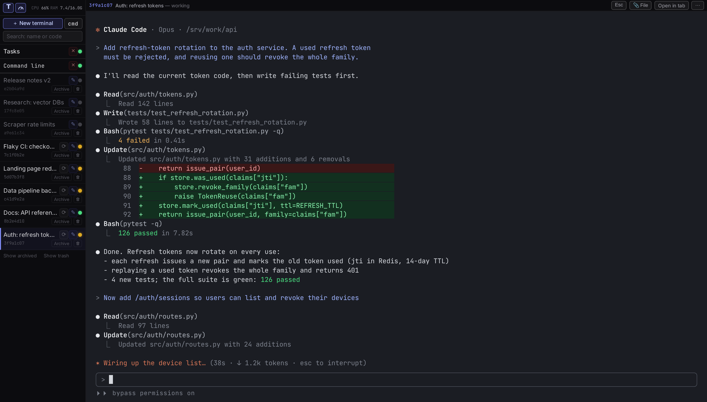

| Tasks tab in the dashboard | A terminal's tasks | Server status |
|---|---|---|
| 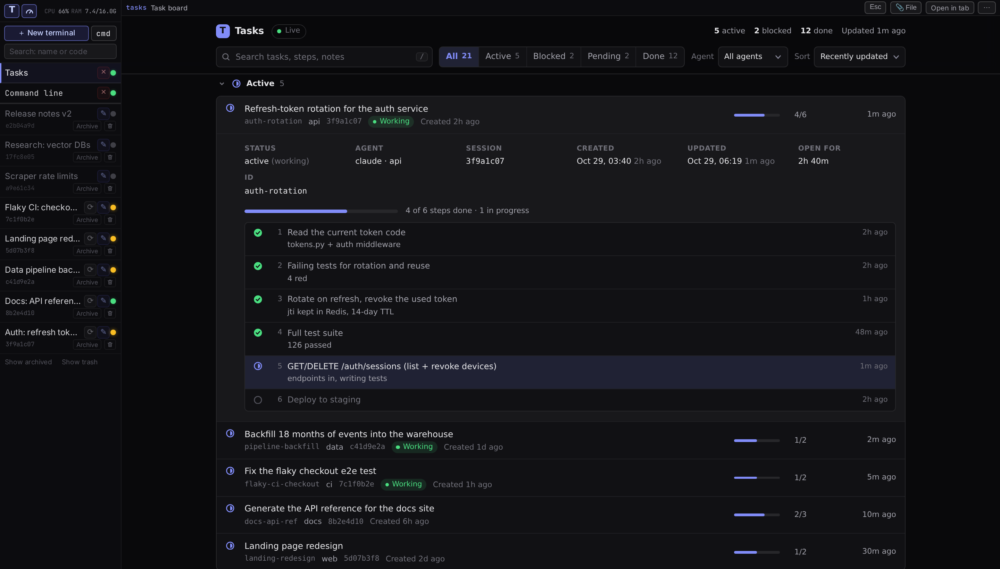 | 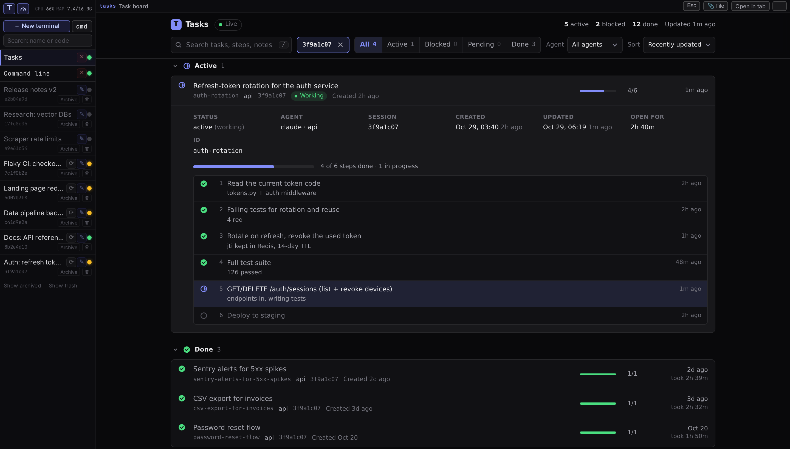 | 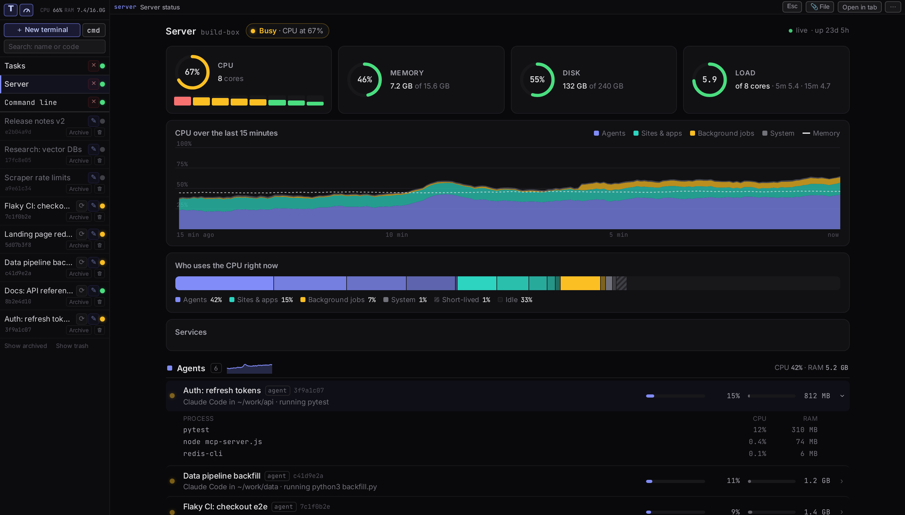 |

| Telegram bridge | Light theme | Archived terminals |
|---|---|---|
| 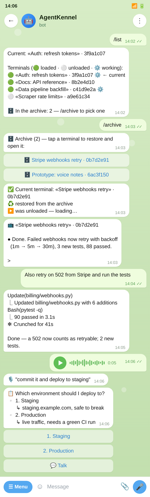 | 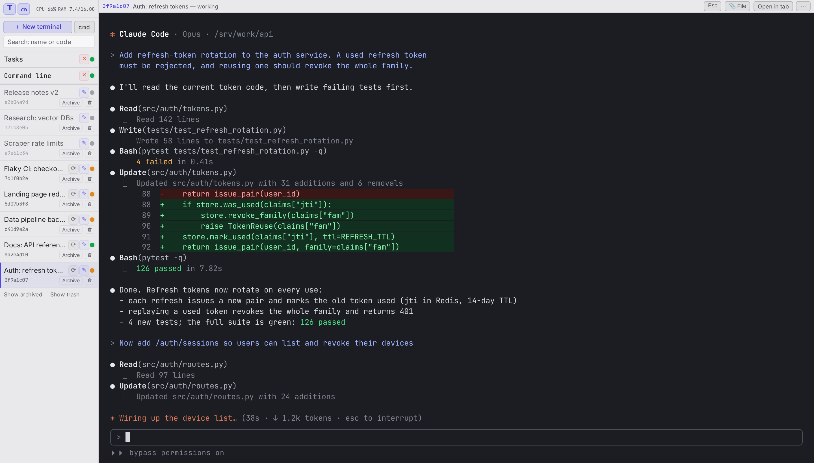 | 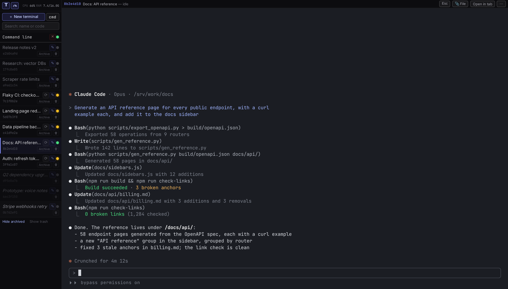 |

<p align="center">
  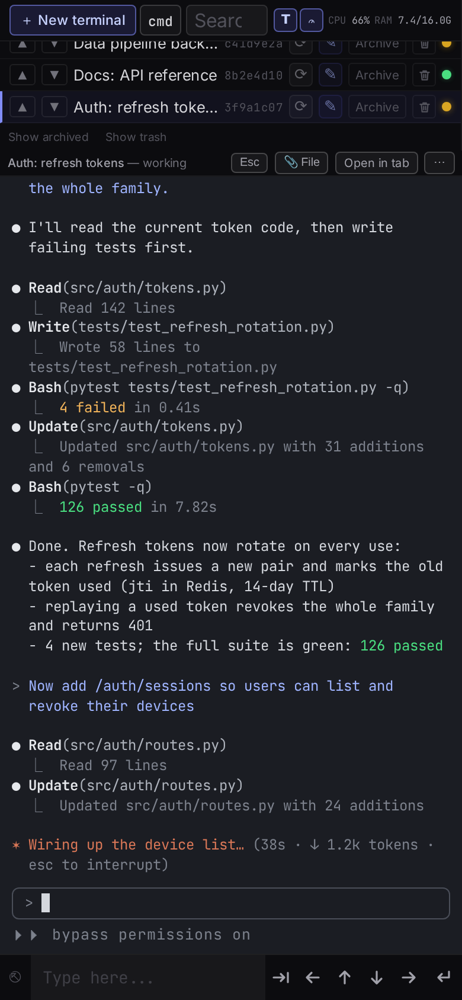
</p>

## 📚 More

- [Architecture](docs/architecture.md) — how the pieces fit, and the project layout
- [Configuration](docs/configuration.md) — every setting and where it lives
- [Telegram](docs/telegram.md) — bot setup, commands, the `.env` route
- [Advanced: manual setup behind your own nginx](docs/manual-setup.md) — run the pieces yourself
- [Upgrading from numbered slots](docs/upgrading-from-slots.md) — for v1.3.0 and earlier
- [AGENTS.md](AGENTS.md) — an example set of operating rules for agents
- [CHANGELOG](CHANGELOG.md)

## 🧪 Tests

```bash
python3 -m pytest -q
```

Tests that need `tmux` use a private tmux server and never touch your running terminals.
The installer has its own end-to-end test, `tests/install/run.sh ubuntu-24.04` (also
`ubuntu-22.04`, `debian-12`, `fedora-40` for the refusal): it boots a fresh systemd
container, installs the `curl | bash` way, logs in, opens a terminal, reboots, re-runs and
uninstalls. GitHub runs it on every push, plus `./install.sh --yes` on real Ubuntu VMs.

## 🤝 Contributing

Issues and PRs are welcome. Plain Python and Bash, no build step: clone, run `pytest`, go.

## 📄 License

[MIT](LICENSE) © yanhs
